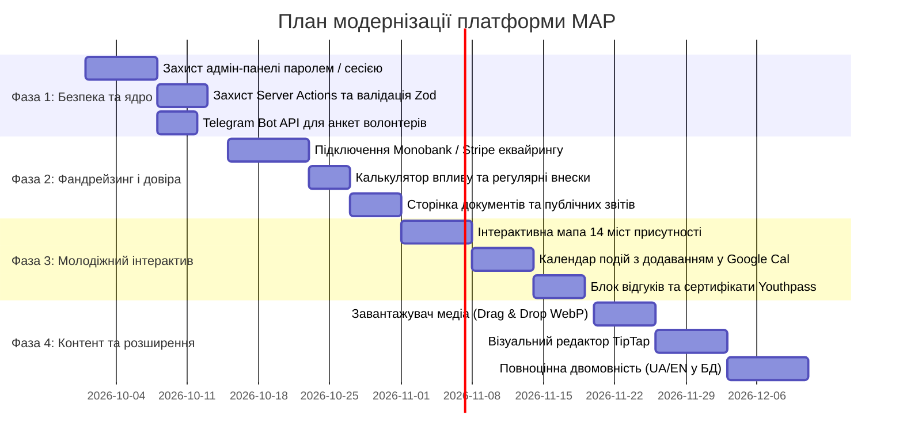

# Комплексний аналіз веб-платформи MAP, дослідження аналогів та дорожня карта покращень

> **Організація:** Асоціація розвитку та соціальної інтеграції молоді «MAP» (*Association for Youth Development and Social Integration*)  
> **Дата дослідження:** Вересень 2026  
> **Стек платформи:** Next.js 16 (App Router), React 19, Tailwind CSS v4, PostgreSQL 16 (Docker) / JSON Fallback Store  

---

## Зміст
1. [Призначення платформи та аналіз поточного стану](#1-призначення-платформи-та-аналіз-поточного-стану)
2. [Дослідження найкращих українських аналогів](#2-дослідження-найкращих-українських-аналогів)
3. [Дослідження міжнародних та закордонних аналогів](#3-дослідження-міжнародних-та-закордонних-аналогів)
4. [Порівняльна матриця можливостей](#4-порівняльна-матриця-можливостей)
5. [Детальний список рекомендованих покращень (Roadmap)](#5-детальний-список-рекомендованих-покращень-roadmap)
   - [Пріоритет 0: Безпека та архітектура (Критично)](#пріоритет-0-безпека-та-архітектура-критично)
   - [Пріоритет 1: Фандрейзинг, довіра та платіжні шлюзи](#пріоритет-1-фандрейзинг-довіра-та-платіжні-шлюзи)
   - [Пріоритет 2: Залучення молоді, волонтерство та CRM](#пріоритет-2-залучення-молоді-волонтерство-та-crm)
   - [Пріоритет 3: Контент-менеджмент (CMS), медіа та багатомовність](#пріоритет-3-контент-менеджмент-cms-медіа-та-багатомовність)
   - [Пріоритет 4: SEO, технічна оптимізація та аналітика](#пріоритет-4-seo-технічна-оптимізація-та-аналітика)
6. [Фази та план впровадження](#6-фази-та-план-впровадження)

---

## 1. Призначення платформи та аналіз поточного стану

### 1.1. Головна місія та мета проєкту
Веб-платформа **MAP** є офіційним цифровим представництвом громадської організації, покликаної сприяти всебічному розвитку, розкриттю лідерського потенціалу та соціальній інтеграції молоді через:
* **Неформальну освіту:** воркшопи, тренінги, soft-skills курси, проєктний менеджмент;
* **Соціальну інтеграцію та підтримку ВПО:** адаптаційні хаби, арт-терапія, клуби психологічної підтримки для внутрішньо переміщеної молоді;
* **Міжнародні можливості:** молодіжні обміни та партнерські проєкти за програмою Erasmus+;
* **Волонтерський рух:** мережа активних молодіжних лідерів у 14 містах України.

### 1.2. Цільові аудиторії
1. **Молодь та студенти (16–25+ років):** шукають можливості для саморозвитку, безкоштовні освітні курси, закордонні стажування та нетворкінг.
2. **Волонтери та координатори:** бажають долучитися до організації подій, набути практичного досвіду для майбутньої кар'єри.
3. **Міжнародні донори та грантодавці (Erasmus+, ЄС, USAID, посольства):** оцінюють прозорість, інституційну спроможність та реалізовані кейси організації.
4. **Благодійники та соціально відповідальний бізнес:** надають фінансову підтримку проєктам.

### 1.3. Поточна технічна реалізація та архітектура
* **Frontend:** Next.js 16 (App Router), React 19, Lucide Icons, адаптивний темний інтерфейс у відтінках `#081626` / Deep Navy.
* **База даних:** PostgreSQL 16 у Docker-контейнері з веб-інтерфейсом Pgweb на порту 8080.
* **Резервний механізм:** Автоматичний fallback на JSON-сховище (`data/map_database.json`) у разі відсутності підключення до PostgreSQL.
* **Ключова концепція — «Zero-Rebuild Real-Time CMS»:**
  * Інлайн-редагування текстів на сторінках (Hero-банер, лічильники, блок історії);
  * Створення та редагування карток проєктів, новин, членів команди;
  * Панель адміна з переглядом вхідних повідомлень та заявок волонтерів.

---

## 2. Дослідження найкращих українських аналогів

| Організація / Платформа | Спеціалізація | Ключові сильні сторони сайту | Що варто перейняти для MAP |
| :--- | :--- | :--- | :--- |
| **[Українська Волонтерська Служба](https://volunteer.country/) (УВС)** | Національна платформа волонтерства | • База можливостей із фільтрами за містом і сферою. • Чат-боти для миттєвих сповіщень. • Сертифікати волонтерських годин. | Створити повноцінний «Банк можливостей» замість статичної форми; Telegram-бот сповіщення. |
| **[БУР (Будуємо Україну Разом)](https://bur.org.ua/)** | Волонтерські табори, інтеграція молоді | • Візуальний сторітелінг та мерч-шоп. • Інтерактивна мапа осередків і таборів. • Публічні річні аудити й фінзвіти (PDF). | Інтерактивна мапа 14 міст присутності MAP; розділ публічної фінансової звітності. |
| **[ГО «Молодіжна платформа»](https://youthplatform.com.ua/)** | Розвиток молодіжних рад та центрів | • Каталог грантових та навчальних програм. • Системна співпраця з UNICEF та Мінмолодьспорту. | Окремий блок для інституційних партнерів і донорів. |
| **[AIESEC в Україні](https://aiesec.ua/)** | Міжнародні молодіжні стажування | • Чітка конверсійна воронка реєстрації. • Відеовідгуки учасників минулих хвиль. | Відео-візитки та відгуки випускників Академії лідерства. |
| **[СпівДія](https://spivdiia.org.ua/)** | Підтримка молоді та інтеграція ВПО | • Розподіл на чіткі напрями допомоги. • Особистий кабінет користувача. | Чітке розділення: «Шукаю можливості» vs «Хочу допомогти». |

---

## 3. Дослідження міжнародних та закордонних аналогів

### 3.1. [Youth Express Network (Y-E-N)](https://youthexpressnetwork.org/) *(Франція / Пан'європейська мережа)*
* **Профіль:** Європейська мережа з понад 30 молодіжних організацій у 19 країнах, головний фокус — **соціальна інтеграція молоді з меншими можливостями** (прямий європейський аналог MAP).
* **Унікальні фішки:**
  * **Toolkits & Publications:** Бібліотека відкритих посібників, гайдів із фасилітації та цифрового сторітелінгу для молодіжних лідерів.
  * **Структуровані треки:** Чіткий розподіл на *Mobility Projects* (обміни), *Capacity Building* (підготовка тренерів) та *Advocacy*.
  * **Партнерські сторінки:** Публічний реєстр партнерських організацій для спільних заявок на гранти Ради Європи та Erasmus+.

### 3.2. [DoSomething.org](https://www.dosomething.org/) *(США / Глобально)*
* **Профіль:** Найбільша цифрова платформа молодіжного активізму та волонтерства у світі (понад 5 млн учасників).
* **Унікальні фішки:**
  * **Кампанії дій замість пасивних новин:** Користувач бачить не просто статтю, а заклик до конкретної мікро-дії (*«Take Action in 10 minutes»*).
  * **Гейміфікація та визнання:** Молодь отримує електронні сертифікати волонтерського досвіду для резюме та вступу до вишів.
  * **Дизайн для Gen Z:** Динамічний, висококонтрастний візуальний стиль без перевантаження сухими текстами.

### 3.3. [The King's Trust (раніше The Prince's Trust)](https://www.kingstrust.org.uk/) *(Велика Британія / Міжнародна)*
* **Профіль:** Еталонна світова інституція з розвитку молодіжного лідерства, працевлаштування та підприємництва.
* **Унікальні фішки:**
  * **«Find a Programme» Wizard:** Інтерактивний покроковий помічник (*«Скільки тобі років?» ➔ «Яке твоє місто?» ➔ «Чого ти прагнеш?»*).
  * **Social ROI / Impact Reporting:** Інтерактивна інфографіка — скільки людей інтегровано в суспільство та яка соціальна віддача на кожен фунт благодійних внесків.
  * **Портал корпоративних партнерів:** Зручний інтерфейс для бізнесу, який готовий спонсорувати молодіжні хаби.

### 3.4. [Kiron Open Higher Education](https://kiron.ngo/) *(Німеччина / Міжнародна)*
* **Профіль:** Провідна платформа онлайн-освіти та соціальної інтеграції біженців, переміщених осіб та вразливої молоді.
* **Унікальні фішки:**
  * **Двостороння головна сторінка:** Чітке розведення потоків: *«Я студент / шукаю навчання»* та *«Я партнер / хочу підтримати»*.
  * **Success Stories у форматі кейсів:** Історії молодих людей з фото, деталями «до» та «після» проєкту, цитатами та посиланнями на їхні успіхи.

### 3.5. [Restless Development](https://restlessdevelopment.org/) *(Велика Британія / Global)*
* **Профіль:** Глобальна молодіжна агенція, що впроваджує підхід *Youth-led Development* (молодь веде проєкти самостійно).
* **Унікальні фішки:**
  * **Open Data & Фінансова відкритість:** Повна публічна звітність, кошториси та структура розподілу фондів.
  * **Youth Hub (Спільнота контенту):** Статті та репортажі створюються самими учасниками програм.

### 3.6. [SALTO-YOUTH & European Solidarity Corps](https://youth.europa.eu/) *(Європейський Союз)*
* **Профіль:** Офіційна інфраструктура ЄС для молодіжних проєктів, волонтерства та обмінів Erasmus+.
* **Унікальні фішки:**
  * **Youthpass Certification:** Європейський стандарт підтвердження компетенцій, здобутих у неформальній освіті.
  * **Otlas Partner Finding:** Інструмент пошуку партнерів для міжнародних консорціумів.

---

## 4. Порівняльна матриця можливостей

| Критерій / Функціонал | MAP (Поточний стан) | Українські аналоги (УВС, БУР) | Закордонні аналоги (Y-E-N, DoSomething, King's Trust) | Оцінка потреби для MAP |
| :--- | :--- | :--- | :--- | :---: |
| **Безпека адмін-доступу** | Клієнтський перемикач у `localStorage` без пароля | Авторизація через пароль/OTP, ролі (Admin/Editor) | Двофакторна автентифікація, Role-Based Access Control | 🔴 **Критично (P0)** |
| **Платіжний шлюз донатів** | Статичний IBAN + імітація успіху через таймер | Інтегровані LiqPay, Monobank, Portmone | Stripe, PayPal, регулярні підписки (Recurrent), калькулятор впливу | 🔴 **Критично (P1)** |
| **Публічна звітність** | Відсутня (тільки текстові лічильники) | Річні PDF-звіти, аудити, реєстраційні документи | Інтерактивний Impact Dashboard, Open Data, Social ROI | 🟡 **Висока (P1)** |
| **Календар та афіша подій** | Відсутній (лише ретроспективні новини) | Анонси з дедлайнами реєстрацій, чат-боти | Інтерактивний розклад, синхронізація з Google Calendar | 🟡 **Висока (P1)** |
| **Інтерактивна мапа** | Текстовий рядок («14 міст») | Інтерактивні мапи осередків, таборів, хабів | Гео-трекінг реалізованих проєктів | 🟡 **Висока (P2)** |
| **Анкета волонтера** | Модальна форма без вибору напряму | База вакансій, верифікація волонтера, кабінет | Банк мікро-завдань, фільтр за навичками та містом | 🟡 **Висока (P2)** |
| **Завантаження медіа (CMS)** | Вставка зовнішнього URL на фото | Завантаження в хмару, медіа-бібліотека | Оптимізація WebP, Drag & Drop, CDN | 🟢 **Середня (P3)** |
| **Редактор статей** | Вставка сирих HTML-тегів | WYSIWYG / Markdown редактор | Блоковий редактор (Notion-like), галереї, цитати | 🟢 **Середня (P3)** |
| **Багатомовність** | Інтерфейсні фрази (контент БД лише UA) | 1–2 мови (UA / EN) | Повна багатомовність, автопереклад контенту | 🟢 **Середня (P3)** |

---

## 5. Детальний список рекомендованих покращень (Roadmap)

### Пріоритет 0: Безпека та архітектура (Критично)
1. **Захист панелі керування та Server Actions:**
   * Створити захищену сторінку входу `/admin/login` із паролем та сесією (через `iron-session` або `NextAuth.js` / Supabase Auth).
   * Захистити всі функції у `src/lib/actions/contentActions.ts` серверною перевіркою валідності сесії `verifyAdminSession()`.
   * Прибрати відкритий прапорець `map_is_admin` із `localStorage`.
2. **Валідація вхідних даних (Zod):**
   * Впровадити схеми валідації `zod` для форм створення новин, проєктів та анкет волонтерів для запобігання XSS-ін'єкціям та некоректним даним.

---

### Пріоритет 1: Фандрейзинг, довіра та платіжні шлюзи
1. **Інтеграція реального еквайрингу:**
   * Підключити **Monobank Acquiring** або **LiqPay** для прийому донатів у гривні в один клік через Apple Pay / Google Pay.
   * Підключити **Stripe** для підтримки міжнародних благодійників (EUR / USD).
   * Додати можливість **щомісячного регулярного донату** (рекурентні платежі).
2. **«Калькулятор соціального впливу» у вікні донату:**
   * При виборі суми показувати конкретний результат:
     * *150 ₴* ➔ кава-брейк і матеріали для 2 учасників адаптаційного клубу ВПО;
     * *500 ₴* ➔ навчальний комплект для підлітка на курсі цифрових навичок;
     * *1 500 ₴* ➔ проживання та харчування волонтера на триденному молодіжному обміні.
3. **Розділ «Прозорість та звітність» (Institutional Credibility):**
   * Окрема сторінка або блок із відкритими документами:
     * Статут ГО «МАР», Виписка з ЄДРПОУ, Довідка про неприбутковість;
     * Річні описові та фінансові звіти у форматі PDF для завантаження;
     * Це головна вимога європейських донорів (Erasmus+, European Youth Foundation).

---

### Пріоритет 2: Залучення молоді, волонтерство та CRM
1. **Миттєві сповіщення через Telegram Bot API:**
   * При заповненні анкети волонтера або форми контактів автоматично надсилати сповіщення в закритий робочий Telegram-чат координаторів MAP.
2. **Афіша та Календар подій:**
   * Додати до проєктів та новин статус події: дата, час, місце (або Zoom), дедлайн реєстрації.
   * Додати кнопку *«Зберегти в Google Календар / Apple Calendar»*.
3. **Інтерактивна мапа 14 міст України:**
   * Візуалізувати присутність MAP на клікабельній карті України з точками осередків, контактами регіональних координаторів та переліком проведених заходів.
4. **Валідація навичок за стандартом Youthpass:**
   * Додати на сторінки освітніх проєктів позначку про видачу офіційного сертифіката неформальної освіти **Youthpass** (стандарт ЄС).
5. **Банк мікро-завдань (DoSomething-модель):**
   * Можливість допомогти організації тут і зараз: *«Допоможи з дизайном постера»*, *«Пошир інформацію в університетському чаті»*, *«Долучись до мовного клубу»*.

---

### Пріоритет 3: Контент-менеджмент (CMS), медіа та багатомовність
1. **Завантаження файлів та зображень (Media Upload):**
   * Замінити вставку прямих посилань з Unsplash на повноцінний Drag & Drop завантажувач у хмарне сховище (Cloudinary, AWS S3 або локальне `public/uploads`) з автоконвертацією у WebP.
2. **Сучасний візуальний редактор (Rich Text Editor):**
   * Інтегрувати бібліотеку **TipTap** або **Lexical** для інтуїтивного форматування тексту статей без необхідності ручного введення HTML-тегів.
3. **Повноцінна двомовність (UA / EN):**
   * Розширити таблиці бази даних полями `title_en`, `content_en`, `short_desc_en` для можливості презентувати проєкти міжнародним партнерам англійською мовою.
4. **Секція «Історії успіху та відгуки» (Alumni Stories):**
   * Картки з цитатами, фотографіями та відео-відгуками молодих людей, які змінили своє життя завдяки проєктам MAP.
5. **Блок партнерів та донорів:**
   * Слайдер або сітка логотипів партнерських інституцій (Erasmus+, молодіжні центри, державні органи, міжнародні фонди).

---

### Пріоритет 4: SEO, технічна оптимізація та аналітика
1. **Динамічні OpenGraph (OG) зображення:**
   * Налаштувати `opengraph-image.tsx` у Next.js, щоб при поширенні посилання на статтю або проєкт у Telegram/Facebook формувалося гарне брендоване прев'ю з назвою та обкладинкою.
2. **Семантична мікророзмітка Schema.org:**
   * Додати JSON-LD розмітку типів `NGO / NonProfitOrganization`, `Event` (для тренінгів) та `NewsArticle` (для новин) для покращення індексації в Google.
3. **Політика конфіденційності та згода на обробку персональних даних:**
   * Додати обов'язковий чекбокс згоди з політикою конфіденційності (GDPR / закон України про захист персональних даних) у форми волонтерів та зворотного зв'язку.
4. **Веб-аналітика:**
   * Підключити Google Analytics 4 або орієнтовану на приватність аналітику (Plausible) для відстеження конверсії заявок та донатів.

---

## 6. Фази та план впровадження

---
*Документ створено автоматично на основі аналізу кодової бази `map-website` та актуальних практик світового і вітчизняного молодіжного сектору.*
